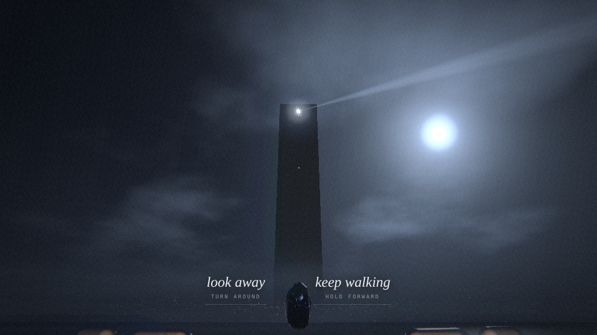
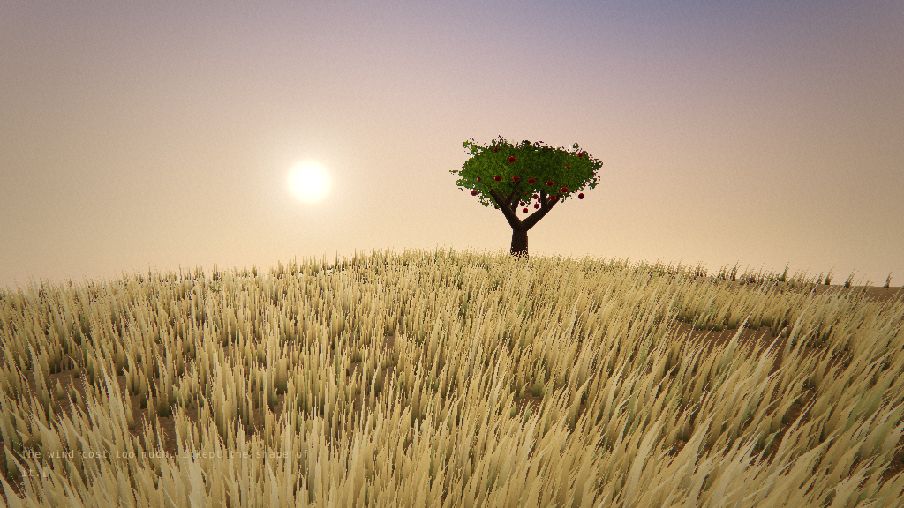
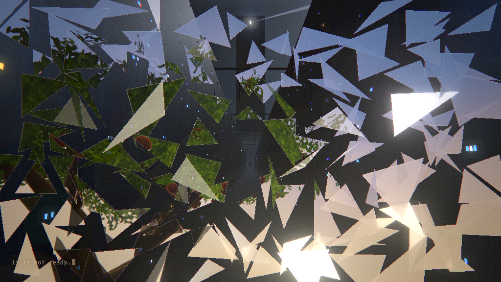
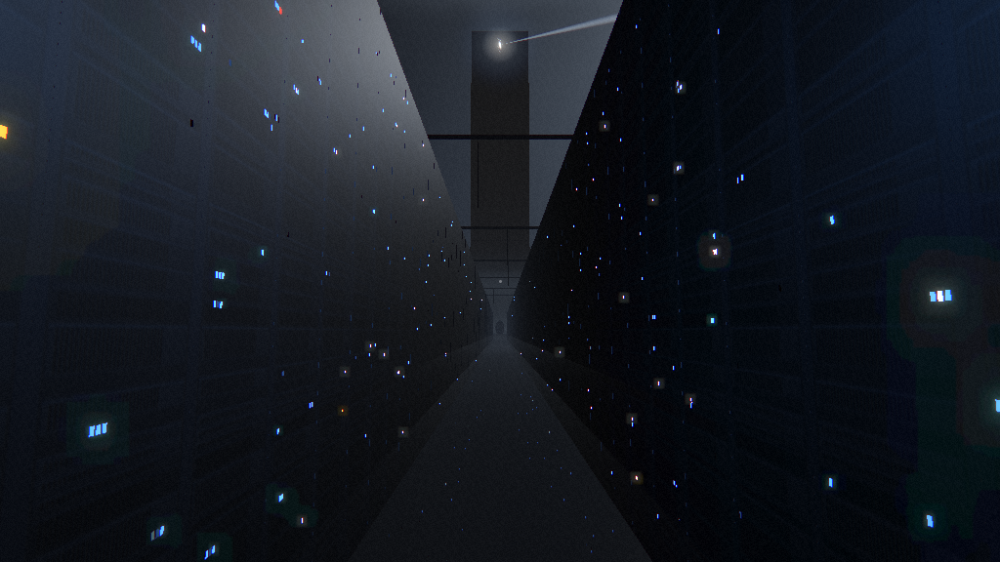
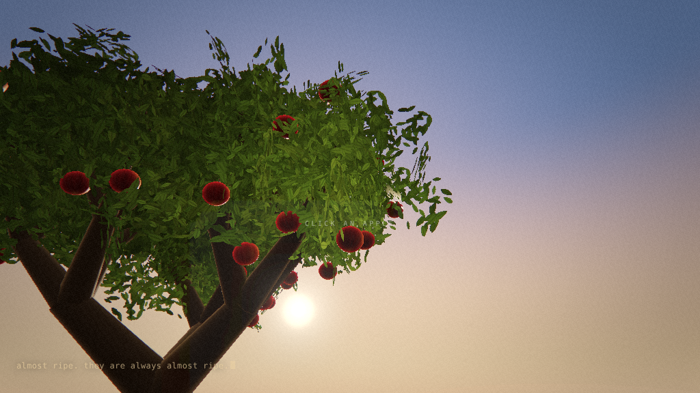

# Almost Ripe



*A night inside the Caretaker.* An original interactive story, about three minutes long, made in three.js.

Five people are left. Something keeps them. Every night it rebuilds the world from what they remember, almost perfectly.

## Play it

Open `almost-ripe.html` in a recent desktop or mobile browser. It is a single file; it needs an internet connection the first time, to load three.js and two fonts. Headphones help: all of the sound is part of the piece.

If your browser blocks local files, serve the folder instead:

```bash
python3 -m http.server 8000   # then open http://localhost:8000/almost-ripe.html
```

| Action | Input |
|---|---|
| Start | click, or <kbd>Enter</kbd> / <kbd>Space</kbd> |
| Walk | <kbd>W</kbd> <kbd>A</kbd> <kbd>S</kbd> <kbd>D</kbd> or the arrow keys |
| Look | drag |
| Mute | <kbd>M</kbd> |

`prefers-reduced-motion` is respected.

## How it is made

- One HTML file: the scene, the story, the shaders and the sound are all inline.
- Every surface, light and sound is generated in code: three.js for the world (with bloom post-processing), Web Audio for the score and effects. There are no image, model or audio files.
- three.js 0.147.0 loads from jsDelivr; Cormorant Garamond and IBM Plex Mono load from Google Fonts.

## Screenshots

| | |
|---|---|
|  |  |
|  |  |

## License

Code: MIT. See [LICENSE](LICENSE). three.js is MIT; the fonts are under the SIL Open Font License.

Built with Claude.
